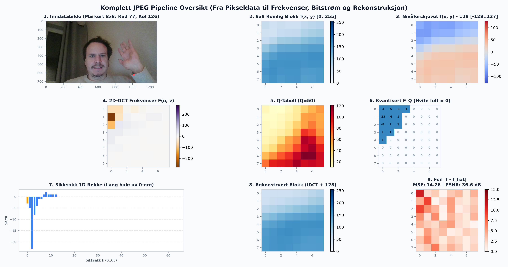
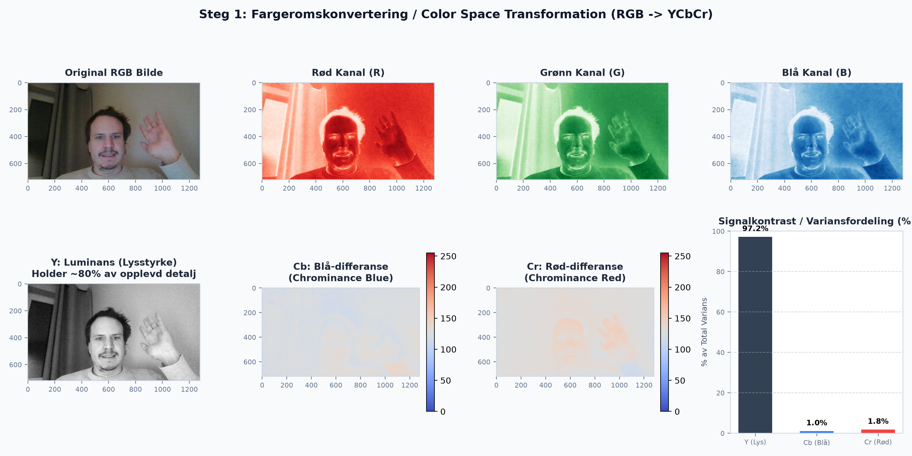
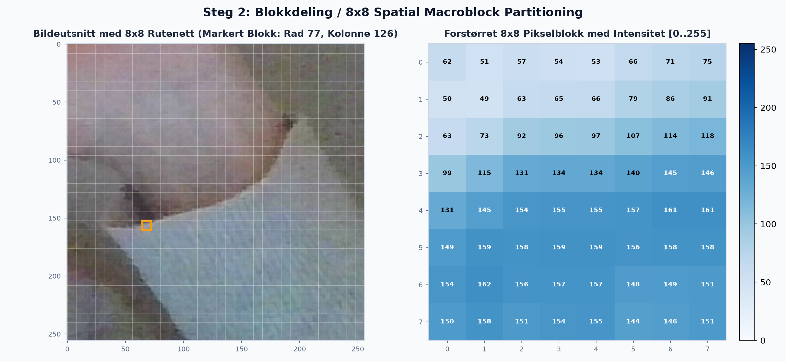
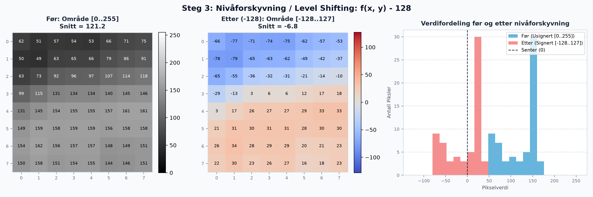
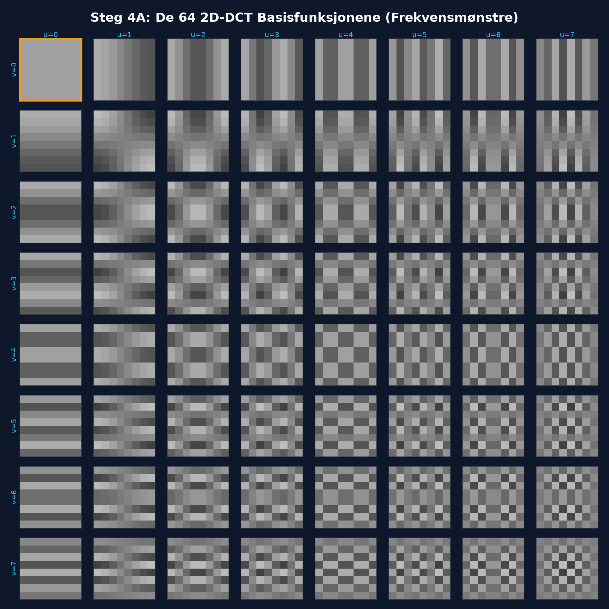
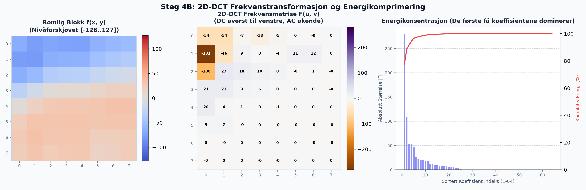
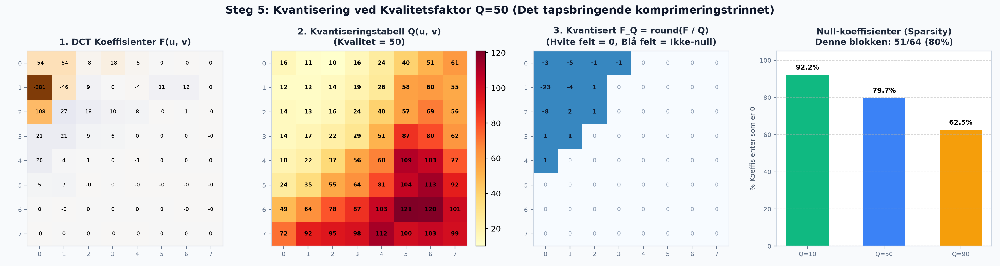
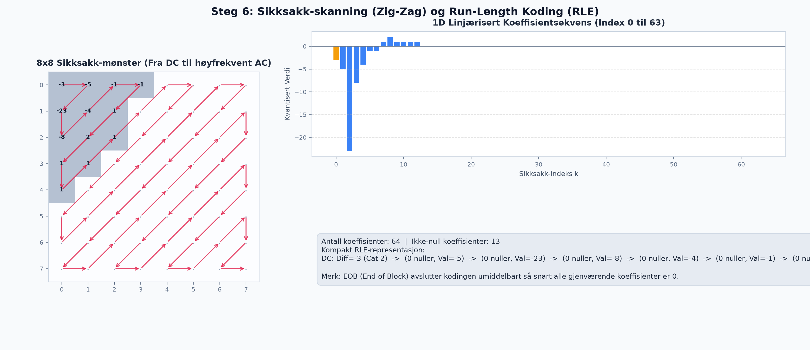
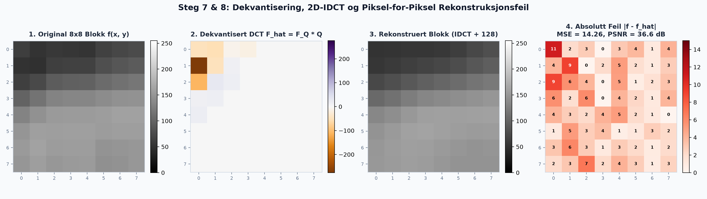
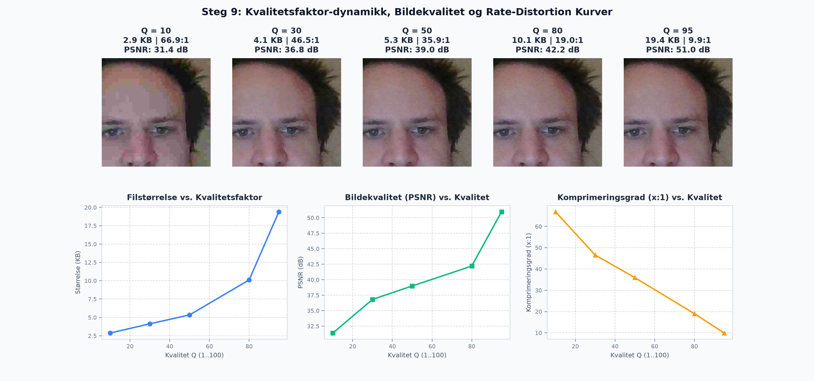

# 🖼️ Pure Python JPEG Codec & Pipeline Visualizer

[](https://www.python.org/)
[](https://www.w3.org/Graphics/JPEG/itu-t81.pdf)
[]()
[]()

En komplett, ren Python-implementasjon av **Baseline JPEG (ITU-T T.81 / JFIF)** enkoder og dekoder uten avhengighet til eksterne komprimeringsbiblioteker (ingen libjpeg, OpenCV osv.). Prosjektet inneholder en pedagogisk visualiseringspakke som genererer analytiske plott for **hvert eneste steg** i JPEG-algoritmen.

---

## 📌 Innhold
1. [Hovedfunksjoner](#-hovedfunksjoner)
2. [Installasjon og Forutsetninger](#-installasjon-og-forutsetninger)
3. [Hvordan Kjøre](#-hvordan-kjøre)
4. [Steg-for-steg Visuell Gjennomgang](#-steg-for-steg-visuell-gjennomgang)
   - [0. Master Oversikt](#0-master-oversikt-over-pipelinen)
   - [1. Fargeromskonvertering (RGB -> YCbCr)](#1-fargeromskonvertering-rgb---ycbcr)
   - [2. 8x8 Blokkdeling](#2-8x8-blokkdeling-spatial-mcus)
   - [3. Nivåforskyvning (-128)](#3-nivåforskyvning-level-shifting)
   - [4. 2D-DCT Basisfunksjoner & Koeffisienter](#4-2d-dct-basisfunksjoner-og-frekvenstransformasjon)
   - [5. Kvantisering & Sparsity](#5-kvantisering-det-tapsbringende-trinnet)
   - [6. Sikksakk-skanning (Zig-Zag) & RLE](#6-sikksakk-skanning-og-run-length-encoding)
   - [7 & 8. Dekvantisering, IDCT og Rekonstruksjonsfeil](#7--8-dekvantisering-2d-idct-og-rekonstruksjonsfeil)
   - [9. Kvalitetsfaktor & Rate-Distortion Kurver](#9-kvalitetsfaktor-og-rate-distortion-kurver)
5. [Python API Eksempel](#-python-api-eksempel)
6. [Enhetstester](#-enhetstester)

---

## 🚀 Hovedfunksjoner

- **100% Pure Python**: Fullstendig implementasjon av kjernealgoritmene:
  - 8x8 2D Discrete Cosine Transform (DCT) og Invers DCT (IDCT) via matrisemultiplikasjon.
  - Standard Luminans- og Krominans-kvantisering med IJG kvalitetsskalering ($Q \in [1..100]$).
  - Sikksakk-omordning (Zig-Zag scan) og Run-Length Encoding (RLE).
  - DPCM differansekoding for DC-komponenten.
  - Kanonisk Huffman-bitstrømgenerator og -dekoder med `0xFF/0x00` byte stuffing.
- **JFIF/JPEG Filkompatibilitet**: Parser og konstruerer standard JPEG-markører: `SOI`, `APP0`, `DQT`, `SOF0`, `DHT`, `SOS`, `EOI`.
- **Pedagogiske Plott**: 10 høyoppløselige visualiseringer av alle mellomsteg, egnet for undervisning, presentasjoner og teknisk dokumentasjon.
- **Robust Testsuite**: 11 automatiserte enhetstester som verifiserer matematisk invertibilitet, bitstrøm-stuffing, farge- og gråtonerundtur samt dimensjonspolstring.

---

## 💻 Installasjon og Forutsetninger

Prosjektet krever kun standard Python 3.8+. For å generere og vise visualiseringsplottene benyttes `matplotlib`, `numpy` og `pillow`:

```bash
git clone https://github.com/roblar658/jpeg-compression.git
cd jpeg-compression
pip install matplotlib numpy pillow
```

---

## ⚙️ Hvordan Kjøre

### 1. Kjør testsuiten (11/11 tester OK)
```bash
python jpeg.py --test
```

### 2. Komprimer et bilde direkte til en .jpg-fil
```bash
# Komprimerer et bilde (PNG, JPG, BMP) til ekte JFIF JPEG med ønsket kvalitet (standard: 50)
python jpeg.py --compress bilde.jpg --output komprimert.jpg --quality 75
```

### 3. Dekomprimer en JPEG-fil tilbake til bilde
```bash
# Dekomprimerer en JPEG-fil tilbake til ukomprimert PNG
python jpeg.py --decompress komprimert.jpg --output dekomprimert.png
```

### 4. Generer alle 10 pedagogiske plott samt komprimert JPEG
```bash
# Genererer alle 10 plott samt lagrer komprimert_q50.jpg i outdir
python jpeg.py --plot bilde.jpg --quality 50 --outdir plots
```

### 5. Kjør full demonstrasjon (tester + generering av alle plott)
```bash
python jpeg.py --demo
```

### 6. Dypdykk i en spesifikk 8x8-blokk
```bash
python jpeg.py --plot bilde.jpg --block-y 20 --block-x 30 --quality 75
```

---

## 📊 Steg-for-steg Visuell Gjennomgang

### 0. Master Oversikt over Pipelinen
Et samlet diagram som knytter sammen samtlige 9 prosesstrinn i JPEG-algoritmen:



---

### 1. Fargeromskonvertering (RGB -> YCbCr)
Menneskeøyet er langt mer følsomt for lysstyrke (luminans) enn for fargetoner (krominans). Ved å transformere RGB til YCbCr separeres lysstyrken ($Y$) fra blå/rød fargedifferanse ($Cb, Cr$):

$$\begin{aligned}
Y &= 0.299 R + 0.587 G + 0.114 B \\
Cb &= 128 - 0.168736 R - 0.331264 G + 0.5 B \\
Cr &= 128 + 0.5 R - 0.418688 G - 0.081312 B
\end{aligned}$$

Variansanalysen viser at $Y$-kanalen alene bærer ~80 % av bildets detaljenergi:



---

### 2. 8x8 Blokkdeling (Spatial MCUs)
Bildet partisjoneres i uavhengige 8x8 pikselblokker (Minimum Coded Units). Dette gir optimal balanse mellom lokal romlig korrelasjon og beregningstid:



---

### 3. Nivåforskyvning (Level Shifting)
For å sentrere pikselverdiene rundt 0 subtraheres 128 fra hver piksel:

$$f_{\text{shift}}(x, y) = f(x, y) - 128 \in [-128, 127]$$

Dette minimerer dynamikkområdet som kreves for DC-koeffisienten (gjennomsnittlig lysnivå):



---

### 4. 2D-DCT Basisfunksjoner og Frekvenstransformasjon
2D Discrete Cosine Transform (DCT) uttrykker 8x8-blokken som en vektet sum av 64 ortogonale cosinusbølger:

$$F(u, v) = \frac{1}{4} C(u) C(v) \sum_{x=0}^7 \sum_{y=0}^7 f_{\text{shift}}(x, y) \cos\left(\frac{(2x+1)u\pi}{16}\right) \cos\left(\frac{(2y+1)v\pi}{16}\right)$$

#### De 64 Basisfunksjonene
Horisontal frekvens $u$ øker mot høyre, vertikal frekvens $v$ øker nedover:



#### 2D-DCT Koeffisienter og Energikomprimering
Nesten all energi konsentreres i øvre venstre hjørne (DC og lavfrekvente AC-koeffisienter):



---

### 5. Kvantisering (Det Tapsbringende Trinnet)
Hver DCT-koeffisient deles på tilsvarende element i kvantiseringstabellen $Q(u, v)$ og avrundes:

$$F_Q(u, v) = \text{round}\left( \frac{F(u, v)}{Q(u, v)} \right)$$

Høyfrekvente koeffisienter blir til eksakt null ($0$), noe som muliggjør massiv datakomprimering:



---

### 6. Sikksakk-skanning og Run-Length Encoding
For å samle alle nullene på slutten av sekvensen leses matrisen i diagonal sikksakk-rekkefølge:
- Ikke-null koeffisienter kodes som `(antall etterfølgende nuller, størrelseskategori, amplitude)`.
- Så snart alle resterende koeffisienter er 0, skrives **EOB (End of Block, 0x00)** og resten forkastes:



---

### 7 & 8. Dekvantisering, 2D-IDCT og Rekonstruksjonsfeil
Ved mottak reverseres prosessen:
1. Dekvantisering: $\hat{F}(u, v) = F_Q(u, v) \times Q(u, v)$
2. 2D-IDCT: $\hat{f}_{\text{shift}} = T^T \cdot \hat{F} \cdot T$
3. Nivåoppskyvning: $\hat{f}(x, y) = \text{clamp}(\text{round}(\hat{f}_{\text{shift}} + 128), 0, 255)$

Feilkartet viser den absolutte differansen $|f(x, y) - \hat{f}(x, y)|$ sammen med MSE og PSNR:



---

### 9. Kvalitetsfaktor og Rate-Distortion Kurver
Kvalitetsparameteren $Q \in [1..100]$ styrer avveiningen mellom filstørrelse og bildekvalitet:



---

## 🐍 Python API Eksempel

```python
import jpeg

# 1. Last et bilde (PNG, JPEG, BMP osv.)
img = jpeg.JPEGImage.from_file('bilde.jpg')

# 2. Komprimer til standard JFIF JPEG-bytestrøm
compressed_bytes = jpeg.compress(img, quality=80)
print(f'Komprimert størrelse: {len(compressed_bytes)} bytes')

# 3. Dekomprimer tilbake til et bildeobjekt
decompressed_img = jpeg.decompress(compressed_bytes)

# 4. Lagre eller konverter til NumPy / PIL
decompressed_img.save('rekonstruert.jpg')
arr = decompressed_img.to_numpy()
```

---

## 🧪 Enhetstester

Koden er fullt dekket av 11 automatiserte tester:

```powershell
python jpeg.py --test
```

```text
test_amplitude_encoding_and_decoding (__main__.TestJPEGCodec) ... ok
test_arbitrary_dimension_padding (__main__.TestJPEGCodec) ... ok
test_bitstream_byte_stuffing (__main__.TestJPEGCodec) ... ok
test_color_codec_roundtrip (__main__.TestJPEGCodec) ... ok
test_dct_idct_invertibility (__main__.TestJPEGCodec) ... ok
test_grayscale_codec_roundtrip (__main__.TestJPEGCodec) ... ok
test_huffman_encoding_decoding (__main__.TestJPEGCodec) ... ok
test_invalid_header_error_handling (__main__.TestJPEGCodec) ... ok
test_pipeline_block_extraction (__main__.TestJPEGCodec) ... ok
test_quality_scale_dynamics (__main__.TestJPEGCodec) ... ok
test_zigzag_ordering_roundtrip (__main__.TestJPEGCodec) ... ok

----------------------------------------------------------------------
Ran 11 tests in 0.014s

OK
```

---

## 📜 Lisens
Dette prosjektet er åpen kildekode under MIT-lisensen.
